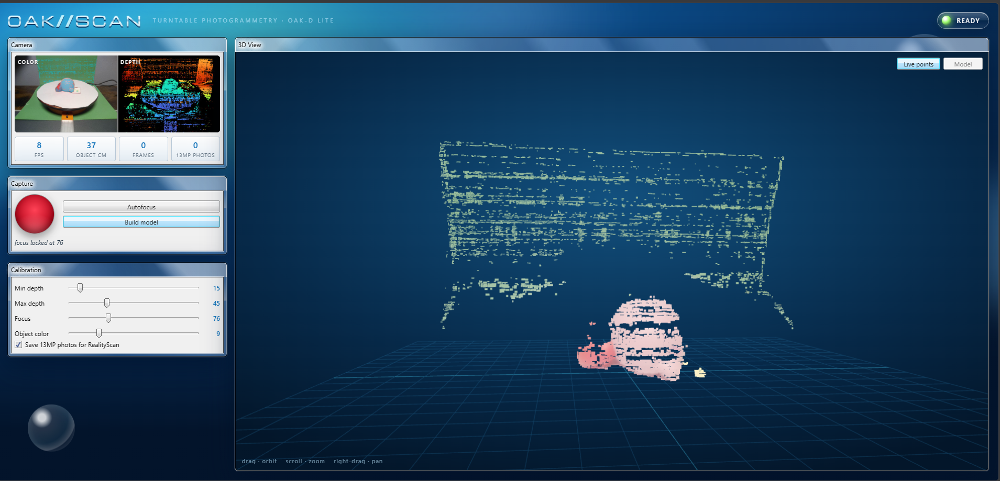
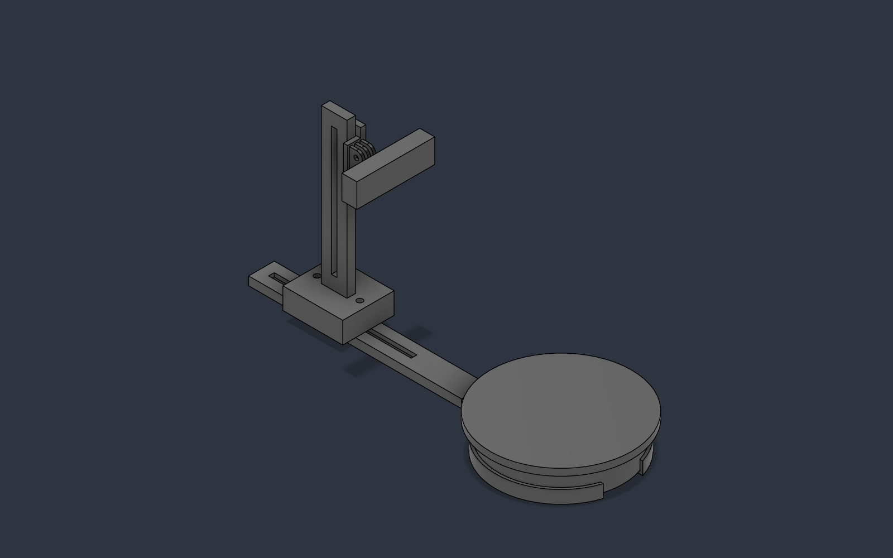
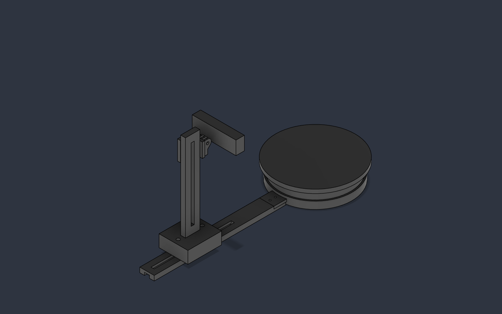
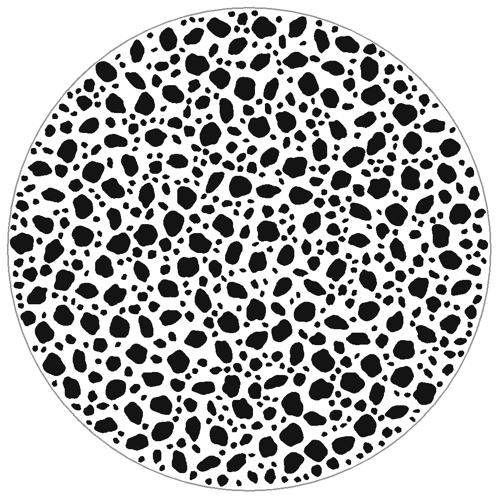

# OAK//SCAN

Turntable 3D scanning with a **Luxonis OAK-D Lite**: a printed camera stand, a speckle platter, a web control UI,
and a photo-to-mesh pipeline through **RealityScan**, ending in an editable model in **Fusion**.



| Scan stand (Fusion, parametric script) | | Speckle platter |
|---|---|---|
|  |  |  |

> **Status:** capture, masking, the web UI and the depth fallback all work. Photogrammetry was blocked by
> the smooth test object on a blank white platter (not enough features to align); the speckle platter is the
> fix and is being printed now. The quad remesh → Fusion T-spline step is planned, not yet automated.

---

## Workflow

```
 OAK-D Lite on the stand          web UI (oak_scan_web.py)               RealityScan (CLI)            Fusion
 ┌───────────────────┐   Record   ┌──────────────────────────┐   Build   ┌─────────────────────┐   ┌──────────────────┐
 │ 13MP stills @ 8/s │──────────▶ │ rec-<time>/photos/*.jpg  │─────────▶ │ masks → align →     │──▶│ insert mesh →    │
 │ + depth + times   │            │ rs_masks.py → *.mask.png │           │ mesh → rs_model.obj │   │ quads → T-spline │
 └───────────────────┘            └──────────────────────────┘           └─────────────────────┘   └──────────────────┘
```

1. **Set up:** speckle platter taped on the turntable, plain backdrop, bright even light, camera about 20–30 cm away.
2. `python oak_scan_web.py` and open **http://127.0.0.1:8765**.
3. **Autofocus.** It sweeps the lens, scores sharpness and locks the best position, so focus can't hunt mid-scan.
4. Start the turntable, then press the **Record** orb. Let it make two full turns, keep hands out of view, and press it again to stop.
5. **Build model.** This writes masks, runs RealityScan headless, and shows the mesh in the 3D view.
6. **Into Fusion (manual for now):** quad remesh with Instant Meshes, then in Fusion use Insert Mesh followed by
   Form → Modify → Convert to get a T-spline. See [Fusion](#into-fusion).

## Install

- Python 3.13 with `pip install depthai opencv-python open3d numpy scipy trimesh` (tested: depthai 3.12, open3d 0.20).
- [RealityScan 2.x](https://www.realityscan.com/) desktop, installed via the Epic Games Launcher. It is free under
  $1M/yr revenue and needs a CUDA GPU to mesh. Its path is `RS` at the top of `oak_scan_web.py`.
- Optional: [Instant Meshes](https://github.com/wjakob/instant-meshes) for quads, and OpenSCAD to regenerate the platter.

## Files

| Path | What |
|---|---|
| `oak_scan_web.py` | Camera + recorder + HTTP server (live preview frames, live points, commands, Build). Reconnects if the camera drops off USB. |
| `web/index.html` | Y2K / Aero-glass UI built with [7.css](https://github.com/khang-nd/7.css) and [three.js](https://threejs.org/). |
| `rs_masks.py` | RealityScan masks (`photo.jpg.mask.png`): keeps what **moves** over the turn (platter + object) versus the median frame, drops the static backdrop and stand. |
| `turntable.py` | Depth-only fallback reconstruction: revolution period, axis and spin direction, then TSDF fusion. `python turntable.py rec-…` |
| `fusion/ScanStand.py` | Parametric Fusion script for the whole stand. Run it from Scripts and Add-Ins; all dimensions are constants at the top. |
| `stl/` | Exported stand parts: Ring, Arm, Foot, Upright, GoPro_slider. |
| `platter/make_platter.py` | Speckle disc generator (OpenSCAD). `make_3mf.py` packs a 3-part Bambu Studio 3MF (`speckle_platter.3mf`). |

## The stand

Built for a 165 mm product turntable (145 mm stationary base, 30 mm tall, control buttons in a 40 mm strip).

- **Ring**: cups the stationary base and is open where the buttons are. The turntable's weight holds it down.
- **Arm**: slotted, so the camera distance adjusts from 200 to 310 mm (upright to center). M6 bolt heads ride in an under-channel.
- **Foot + Upright**: the upright sits in a socket. A vertical slot sets the camera height.
- **GoPro slider**: a 3-prong mount for a 2-prong OAK-D Lite adapter (the camera only has rear M4 holes), clamped by an M6 bolt
  through the slot. It prints standing on its bottom edge with no supports.

**Hardware:** 2× M3 self-tapping screws (ring to arm), 2× M6 bolts with wing nuts (foot to arm), 1× M6 bolt and nut (slider),
1× M5 GoPro thumbscrew, plus a 2-prong OAK-D Lite GoPro adapter, for example
[Matchstic's](https://www.thingiverse.com/thing:5336496) (2× M4×8).

## Speckle platter

A 165 mm white disc with 647 random black blobs (1–8 mm, about 40% coverage) inlaid 0.4 mm deep. Open
`platter/speckle_platter.3mf` in Bambu Studio. It is one object with three parts: two white and one black. It prints
**pattern-face-down** on a textured plate, which gives a matte surface and only about 2 filament changes. Set black to print first
under Plate Settings → First layer filament sequence. Flip it and tape it to the platter so it turns with the object.
To use different AMS slots, run `python make_3mf.py <white_slot> <black_slot>`.

## Into Fusion

1. Quad remesh: `"Instant Meshes.exe" scan.obj -o quads.obj -f 1500 -r 4 -p 4 -d -b`. Leave out `-D`, which
   makes a tri/quad-*dominant* mesh. `-d` is deterministic.
2. In Fusion, use Insert → Insert Mesh (OBJ, mm), then Form → Modify → Convert (select the mesh body) to get an editable T-spline,
   and convert that to a solid. Converting triangle meshes directly ("Organic Mesh Conversion") requires the paid Design Extension.

## Lessons learned

- **The OAK-D Lite's stereo depth is too coarse for small objects.** It is passive (no IR projector), has a 75 mm baseline and
  a minimum range of about 20 cm. A 5 cm figure came out as a lumpy blob, so the 13 MP color camera plus photogrammetry is the way to scan small things.
- **Turntable photogrammetry needs masks and texture.** The static background contradicts the spinning object, and a smooth
  figure on blank paper gave only about 80 matchable features per photo, so RealityScan aligned nothing. Hence the speckle platter.
- RealityScan's AI masking failed on this scene. Masks you supply yourself (`*.mask.png`) are predictable.
- RealityScan CLI errors appear as a **modal dialog**, so a headless run hangs silently. Command names are in
  `Help/en-US/appbasics/allcommands.htm`; it's `-generateAIMasks`, not `-AIMasks`.
- `ScalableTSDFVolume` produced **no geometry** in this open3d 0.20 install, so `UniformTSDFVolume` is used instead.
- Frame-to-frame RGB-D odometry fails on smooth, round objects. On a motorized turntable, angle = time / revolution
  period is far more robust.
- The IMX214 autofocus trigger didn't move the lens, so a sharpness sweep plus manual focus lock is used instead.
- Don't stream the live view as MJPEG. Browsers allow about 6 connections per site, and a dropped stream stays black. The page fetches one
  side-by-side color|depth JPEG at a time instead, so it heals itself, and hidden tabs pause.
- Recording auto-stops after `MAX_REC_S` (120 s). A forgotten recording writes about 30 MB/s of 13 MP photos.
- Full-res stills (actually 4000×3000) via the on-camera MJPEG encoder cap the whole pipeline at `PHOTO_FPS`.

## Credits

[Luxonis depthai](https://github.com/luxonis/depthai-python) · [Open3D](https://www.open3d.org/) ·
[RealityScan](https://www.realityscan.com/) · [7.css](https://github.com/khang-nd/7.css) · [three.js](https://threejs.org/) ·
[Instant Meshes](https://github.com/wjakob/instant-meshes) · OAK-D Lite GoPro adapter by Matchstic.
